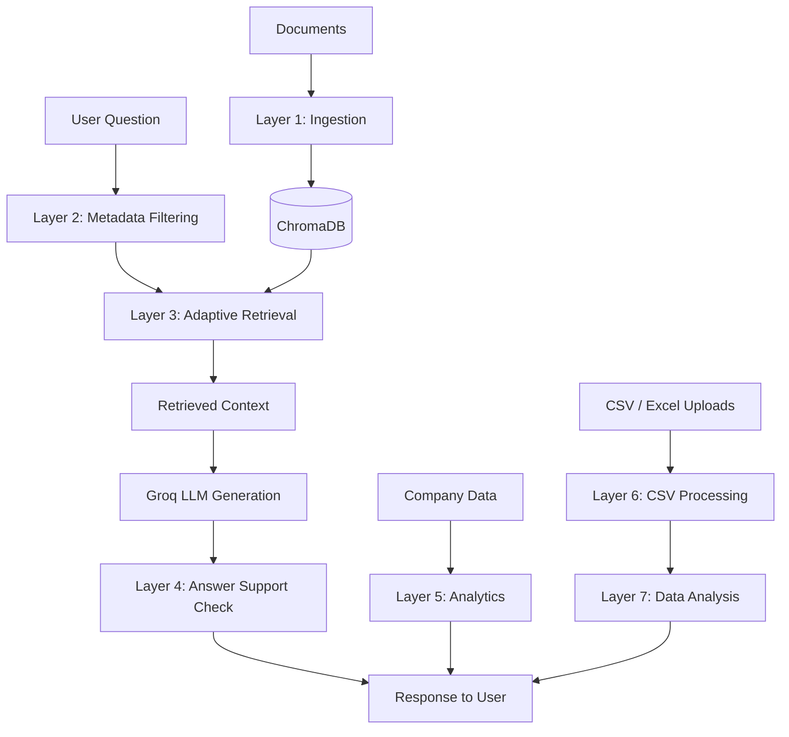

# Intelligent Agentic RAG System

A modular Retrieval-Augmented Generation (RAG) application for enterprise knowledge management. The project combines document retrieval, dynamic metadata filtering, adaptive retrieval retries, similarity-based answer checks, company analytics, and CSV/Excel question answering behind a Flask API and a lightweight browser interface.

**Scope note:** The answer-checking layer uses embedding similarity as a heuristic. It can flag answers that appear weakly supported, but it does not prove factual correctness or guarantee hallucination detection.

## Features

- Document Q&A using retrieved document chunks and Groq-hosted Llama generation.
- Dynamic metadata filtering to narrow retrieval based on query context.
- Adaptive retrieval that retries with relaxed filters when initial retrieval is weak.
- Answer support checks with `verified`, `warning`, and `refused` outcomes.
- Company analytics routed to a dedicated module.
- CSV and Excel analysis for uploaded datasets.
- Browser chat UI for questions and dataset uploads.

## Architecture



## Project Structure

```text
chatbot_rag/
├── chatbot-rag/
│   ├── backend/
│   │   ├── main.py                    # Flask API and query routing
│   │   ├── config.py                  # Model and retrieval configuration
│   │   ├── layer1_ingestion.py        # Chunking, embeddings, vector retrieval
│   │   ├── layer2_dmfe.py             # Dynamic metadata filter extraction
│   │   ├── layer3_aro.py              # Adaptive retrieval orchestration
│   │   ├── layer4_hdp.py              # Similarity-based answer support checks
│   │   ├── layer5_analytics.py        # Company analytics
│   │   ├── layer6_csv_processor.py    # CSV and Excel processing
│   │   ├── layer7_data_analyzer.py    # Natural-language dataset analysis
│   │   └── requirements.txt
│   └── frontend/
│       └── index.html                 # Browser chat interface
└── README.md
```

## Technology Stack

| Area | Technology |
|---|---|
| API | Flask, Flask-CORS |
| Vector store | ChromaDB |
| Embeddings | Sentence Transformers, `all-MiniLM-L6-v2` |
| Answer generation | Groq API, `llama-3.3-70b-versatile` |
| Tabular data | pandas, openpyxl |
| Frontend | HTML, CSS, JavaScript |

## Run Locally

### Prerequisites

- Python 3.10 or newer
- A Groq API key
- Internet access for Groq API requests and the initial embedding-model download

### 1. Create and activate a virtual environment

Run these commands from the repository root:

```bash
cd chatbot-rag/backend
python -m venv .venv
```

**Windows PowerShell**

```powershell
.\.venv\Scripts\Activate.ps1
```

**macOS / Linux**

```bash
source .venv/bin/activate
```

### 2. Install dependencies

```bash
python -m pip install --upgrade pip
pip install -r requirements.txt
```

### 3. Configure the API key

Create a `.env` file in `chatbot-rag/backend/`:

```env
GROQ_API_KEY=your_groq_api_key_here
```

Never commit a real API key. The application reads the key from the environment through `python-dotenv`.

Optional environment variables:

| Variable | Default | Purpose |
|---|---|---|
| `FLASK_HOST` | `127.0.0.1` | Host address for the Flask server |
| `FLASK_PORT` | `5000` | Backend port |
| `FLASK_DEBUG` | `false` | Enable debug mode for local development only |
| `CORS_ORIGINS` | `http://localhost:3000,http://127.0.0.1:3000` | Comma-separated allowed browser origins |
| `UPLOAD_FOLDER` | `chatbot-rag/backend/uploaded_files` | Location for uploaded datasets |

### 4. Start the application

```bash
python main.py
```

The script is expected to start the Flask API at `http://127.0.0.1:5000`, serve the frontend on port `3000`, and open the browser. If port 3000 is already occupied, stop the conflicting process first.

## API Endpoints

### `GET /health`

Returns a basic health response.

### `POST /ask`

Example request body:

```json
{
  "question": "What is the annual leave policy?"
}
```

The response includes an answer, verification status, confidence score, source metadata, and query metadata. The confidence score is a heuristic, not a calibrated probability.

### `POST /upload`

Upload a CSV or Excel file using multipart form data with the field name `file`. The server enforces a 50 MB request-size limit and accepts `.csv`, `.xlsx`, and `.xls` extensions.

### `GET /datasets`

Lists available uploaded datasets and identifies the currently selected dataset.

## Model and Project Acknowledgements

- **Llama 3.3 70B Versatile**, served through Groq: [Groq model documentation](https://console.groq.com/docs/models) · [Llama](https://www.llama.com/)
- **Sentence Transformers `all-MiniLM-L6-v2`** for text embeddings: [Hugging Face model card](https://huggingface.co/sentence-transformers/all-MiniLM-L6-v2)
- **ChromaDB, Flask, and pandas** for vector storage, API serving, and tabular-data processing.

Models, libraries, and trademarks remain the property of their respective owners. This project is an independent implementation and is not endorsed by the model or library maintainers. Review applicable model licences, usage policies, and API-provider terms before redistribution or deployment.

## Current Limitations

- The support-checking layer compares semantic similarity; it is not a factual verifier and may miss unsupported claims or flag valid answers.
- The active uploaded dataset is held in process-level state. This prototype is intended for local, single-user use; concurrent users may interfere with one another's selected dataset.
- Groq-hosted answer generation requires a network connection and a valid API key.
- The Flask development server is intended for local development, not production deployment.
- Uploaded files may contain sensitive information. Use trusted data and do not expose this prototype publicly without authentication, access controls, retention policies, and deployment hardening.

## Engineering Roadmap

- [ ] Add automated tests for API validation, retrieval routing, and answer-status handling.
- [ ] Add CI to run linting and tests on pull requests.
- [ ] Isolate dataset state per user/session and add upload retention controls.
- [ ] Evaluate retrieval quality and answer support checks against a labelled test set.
- [ ] Add source-grounded examples, screenshots, and reproducible evaluation results.
- [ ] Remove generated caches and local vector-store artefacts from version control where applicable.

## Contributing

Use focused branches and small commits, for example:

```text
feat: add session-scoped dataset selection
fix: validate malformed upload requests
docs: clarify retrieval evaluation methodology
test: cover empty-question validation
```

Open a pull request with a concise summary, the motivation for the change, and the tests or manual checks performed.
