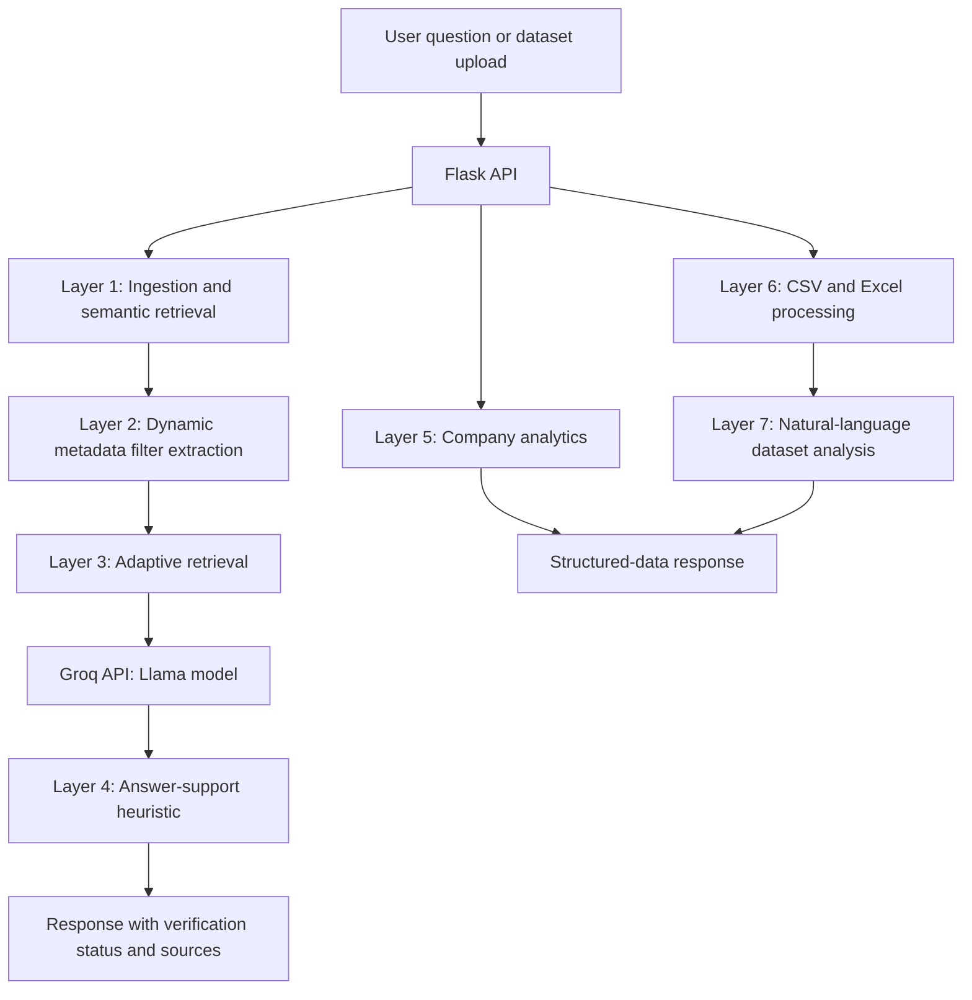

# Intelligent Agentic RAG System

A modular Retrieval-Augmented Generation (RAG) application that combines semantic document retrieval, dynamic metadata filtering, adaptive retrieval, answer-support heuristics, and structured-data analysis.

The project explores how a RAG pipeline can do more than retrieve chunks and generate text: it can refine retrieval when results are weak, expose supporting source metadata, and flag responses that may not be adequately supported by the retrieved context.

> **Project status:** Research and development prototype. It is not yet validated for production or multi-user enterprise deployment.

## Overview

The application provides a browser-based chat interface backed by a Flask API. It supports document question answering, CSV/Excel uploads, company analytics, and natural-language analysis of uploaded datasets.

### Core capabilities

- **Semantic retrieval:** creates text embeddings with Sentence Transformers and stores/retrieves vectors with ChromaDB.
- **Dynamic metadata filtering:** derives metadata constraints from natural-language questions to focus retrieval.
- **Adaptive retrieval:** retries searches with relaxed filters when the initial retrieval does not meet the configured threshold.
- **Answer-support assessment:** compares generated answers with retrieved context using an embedding-similarity heuristic and returns a status such as `verified`, `warning`, or `refused`.
- **Structured-data workflows:** processes CSV and Excel datasets and routes suitable questions to analytics or data-analysis logic.
- **Source-aware responses:** includes metadata about retrieved chunks in document-question-answering responses.
- **Local web interface:** provides a lightweight HTML/CSS/JavaScript frontend served alongside the Flask application during local startup.

## Architecture

The codebase is organized into seven functional layers.



### Layer responsibilities

| Layer | Module | Responsibility |
| --- | --- | --- |
| 1. Ingestion and retrieval | `layer1_ingestion.py` | Chunks documents, creates embeddings, persists vectors, and retrieves relevant content. |
| 2. Dynamic metadata filter extraction | `layer2_dmfe.py` | Extracts metadata constraints from a question. |
| 3. Adaptive retrieval optimization | `layer3_aro.py` | Retries retrieval with adjusted filters when results are insufficient. |
| 4. Hallucination detection heuristic | `layer4_hdp.py` | Estimates answer support using similarity-based checks and produces a status. |
| 5. Company analytics | `layer5_analytics.py` | Routes and answers supported company-analytics questions. |
| 6. CSV/Excel processing | `layer6_csv_processor.py` | Processes tabular files and generates file summaries. |
| 7. Dataset analysis | `layer7_data_analyzer.py` | Supports natural-language analysis of uploaded datasets. |

## Technology stack

| Area | Technology |
| --- | --- |
| Language | Python |
| API | Flask, Flask-CORS |
| LLM inference | Groq API |
| Configured LLM | `llama-3.3-70b-versatile` |
| Embeddings | Sentence Transformers, `all-MiniLM-L6-v2` |
| Vector store | ChromaDB |
| Data processing | Pandas, NumPy, OpenPyXL |
| Configuration | python-dotenv |
| Frontend | HTML, CSS, JavaScript |

## Repository layout

```text
chatbot_rag/
├── README.md
└── chatbot-rag/
    ├── backend/
    │   ├── main.py
    │   ├── config.py
    │   ├── layer1_ingestion.py
    │   ├── layer2_dmfe.py
    │   ├── layer3_aro.py
    │   ├── layer4_hdp.py
    │   ├── layer5_analytics.py
    │   ├── layer6_csv_processor.py
    │   ├── layer7_data_analyzer.py
    │   └── requirements.txt
    └── frontend/
        └── index.html
```

## Getting started

### Prerequisites

- Python compatible with the pinned dependencies in `chatbot-rag/backend/requirements.txt`
- Git
- A Groq API key for LLM inference
- Network access for the Groq API and any first-time model downloads

### 1. Clone the repository

```bash
git clone https://github.com/kshetrika/chatbot_rag.git
cd chatbot_rag
```

### 2. Create and activate a virtual environment

**Windows (PowerShell):**

```powershell
python -m venv .venv
.venv\Scripts\Activate.ps1
```

**macOS / Linux:**

```bash
python3 -m venv .venv
source .venv/bin/activate
```

### 3. Install dependencies

```bash
python -m pip install --upgrade pip
python -m pip install -r chatbot-rag/backend/requirements.txt
```

### 4. Configure the API key

Create a file named `.env` inside `chatbot-rag/backend/` and add:

```dotenv
GROQ_API_KEY=your_groq_api_key
```

The current `config.py` sets the model names and retrieval thresholds in code. Do not commit your real API key or other secrets.

### 5. Run the application

```bash
cd chatbot-rag/backend
python main.py
```

The current startup routine is designed for local development: it starts the Flask API on port `5000`, starts a static frontend server on port `3000`, and attempts to open the frontend in your browser. If automatic browser startup fails, open:

- Frontend: `http://localhost:3000`
- API health check: `http://127.0.0.1:5000/health`

> **Security note:** Review the development server settings in `main.py` before running this application on a shared network or deploying it. The current code enables Flask debug mode and binds the API to `0.0.0.0`; these settings are not appropriate for an internet-facing production deployment.

## API reference

The following routes are defined in `chatbot-rag/backend/main.py`.

| Method | Route | Purpose |
| --- | --- | --- |
| `GET` | `/health` | Returns service health and the currently selected dataset. |
| `POST` | `/ask` | Routes a question to dataset analysis, company analytics, or document Q&A. |
| `POST` | `/upload` | Uploads a supported CSV or Excel dataset. |
| `GET` | `/datasets` | Lists datasets found in the upload directory and reports the current dataset. |

### Ask a question

Example request:

```bash
curl -X POST http://127.0.0.1:5000/ask \
  -H "Content-Type: application/json" \
  -d '{"question":"What information is available in the company documents?"}'
```

A document-Q&A response may include an answer, confidence value, verification status, source metadata, and retrieval metadata. Exact response fields depend on the selected processing path.

### Upload a dataset

The upload endpoint expects a multipart form request with a file field named `file`. The application currently allows `.csv`, `.xlsx`, and `.xls` files.

```bash
curl -X POST http://127.0.0.1:5000/upload \
  -F "file=@./path/to/dataset.csv"
```

Use only datasets you are authorized to process. Review the application's data retention and access-control behaviour before using sensitive information.

## Request lifecycle

For a document question, the intended flow is:

1. Receive a question through the Flask API.
2. Extract potential metadata constraints.
3. Retrieve relevant document chunks from the vector store.
4. Retry retrieval with adjusted filters if the initial results are insufficient.
5. Generate a response using the configured Groq-hosted language model.
6. Compare the response with retrieved context using the answer-support heuristic.
7. Return the answer, status, and available source metadata.

Questions about uploaded datasets and company analytics may be routed to their respective processing layers instead of the document retrieval flow.

## Reliability and known limitations

This project is an engineering prototype, and the following limitations matter when interpreting its output:

- **Similarity is not factual verification.** Embedding similarity cannot prove that an answer is true, complete, or free of hallucinations. The `verified` status should be interpreted as a heuristic result, not a guarantee.
- **Inference uses an external service.** The configured Groq model requires an API key and network access; the application is not fully offline.
- **Dataset selection is process-wide.** The current implementation uses a module-level `current_dataset` variable. Concurrent users can interfere with one another, so multi-user isolation is not yet provided.
- **Confidence values require calibration.** A confidence field is only meaningful if its calculation is grounded and evaluated against labelled examples. Hard-coded values should not be interpreted as measured probabilities.
- **Production hardening remains necessary.** Authentication, authorization, rate limiting, upload validation, privacy controls, structured logging, and production server configuration should be reviewed before deployment.
- **Automated evaluation is needed.** Retrieval quality, answer faithfulness, refusal behaviour, latency, and robustness should be tested on a representative evaluation set.

## Engineering roadmap

- [ ] Add unit and integration tests for all seven layers and API routes.
- [ ] Add a reproducible evaluation dataset and report retrieval/answer-quality metrics.
- [ ] Replace process-wide dataset state with session- or user-scoped storage.
- [ ] Calibrate answer-support thresholds using labelled examples.
- [ ] Add CI checks for formatting, linting, tests, and dependency security.
- [ ] Improve API validation, error handling, authentication, and request limits.
- [ ] Separate development and production configuration.
- [ ] Document data provenance, retention, and licensing for sample datasets.

## Contributing

Contributions are welcome. For changes that affect retrieval behaviour, answer assessment, or API contracts, please include:

1. A concise description of the problem and proposed change.
2. Tests or reproducible steps demonstrating the behaviour.
3. Any relevant impact on performance, reliability, or compatibility.

For substantial changes, open an issue before submitting a pull request.

## License and data

No repository license has been confirmed. Until a license is added, do not assume that reuse, modification, or redistribution is permitted.

Before distributing or deploying the project, review the provenance, permitted use, and privacy implications of any sample or company datasets included in the repository.

## Acknowledgements

The project uses Flask, ChromaDB, Sentence Transformers, Pandas, OpenPyXL, and the Groq API. See `requirements.txt` for the pinned Python dependencies.

---

**Topics:** Retrieval-Augmented Generation (RAG) · Generative AI · LLM Applications · Semantic Search · Adaptive Retrieval · Metadata Filtering · Applied Machine Learning · Data Analytics
